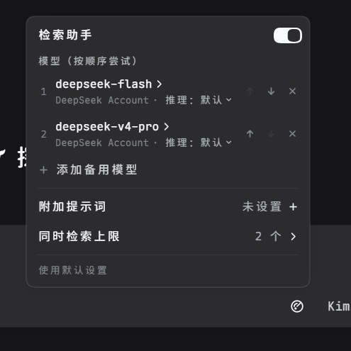

<div align="center">

# dsh-query-scout

### [DeepSeek Harness](https://github.com/deepseek-ai/deepseek-harness) 的只读检索子代理插件

<a href="#使用">使用</a> · <a href="#失败处理">失败处理</a> · <a href="#配置">配置</a> · <a href="#安装">安装</a> · <a href="#安全与风险">安全与风险</a> · <a href="#兼容性">兼容性</a>

<p>
  
  <a href="./LICENSE"></a>
  <a href="#兼容性"></a>
  <a href="#兼容性"></a>
</p>



</div>

***

## dsh-query-scout 是什么

用贵的主模型处理开发或分析任务时，常需要先做大范围检索：读多个文件、搜代码库、查文档或看网页。这类工作读得多、推理少，直接让主模型做既费额度，又会把大量原文塞进主会话上下文；中途手动切到便宜模型、查完再切回来，前缀缓存会失效，后续轮次重新计费反而更贵。

DeepSeek Harness 内置的 `subagent` 工具虽然能指定子模型，但模型需要主模型在调用时自行填写，用户没有直接指定检索模型和开关的入口；在未配置 `subagent/model-selection-policy` 时，内置子代理也受会话路由白名单限制，默认只能沿用父会话的当前模型。

`dsh-query-scout` 在输入框工具栏增加了一个「检索助手」入口，并注册了 `query_scout` 工具。用户在面板里配好检索模型后，主模型遇到大范围的文件或网页检索，就通过 `query_scout` 交给独立的只读子代理完成，只把带出处的报告带回主会话。主模型无需切换，前缀缓存不受影响。

```text
主会话 · 主模型
  │ 调用 query_scout
  ▼
检索助手插件
  │ 按面板配置调度，超出并行上限时排队，失败时换下一个模型
  ▼
只读子代理 · 检索专用模型
  │ 用 read / glob / grep / web_search / web_fetch 检索
  ▼
带出处的报告返回主会话，主模型继续推理
```

## 为什么用 dsh-query-scout

- **不切主模型，保住前缀缓存。** 检索交给子代理，主会话的模型不变。`query_scout` 的定义固定且不含模型名，按会话启停只在历史末尾追加一条状态说明，不改动已有前缀。
- **检索过程不占主模型上下文。** 读文件、搜索和网页原文都留在子代理中，主模型只收一份限长且带出处的报告，同步等待结果，不会因异步通知多跑一轮。
- **在面板里直接指定检索模型。** 随时为当前会话选模型、调推理强度或设为全局默认，不影响主模型，也不用维护内置子代理的路由白名单。工具参数不暴露模型字段，主模型不能自行更换。→ [使用](#使用)
- **按检索量主动委派。** 全局默认启用时，系统提示里带有一段固定指引：无论查网页、读代码还是看文档，涉及三次以上搜索读取，或跨越多个文件、目录、仓库、网页时就交给检索助手；一两次能查完的由主模型自己做。按会话开关不改这段提示。
- **支持备用模型与并行排队。** 可按顺序配置多个候选模型，失败后自动冷却并切换下一个；同时检索数达到上限时自动排队，不直接报错回退给主模型。→ [失败处理](#失败处理)
- **子代理默认只读。** 仅开放文件读取、搜索和网页工具，自动屏蔽全局工具、MCP 工具及 `query_scout` 本身；需要放行特定工具时可通过 `globalToolAllow` 指定。→ [安全与风险](#安全与风险)

## 支持

- 输入框工具栏「检索助手」按钮：开关、按顺序尝试的模型列表（最多 3 个，每个可单独设推理强度）、附加提示词。
- 面板上的修改立即保存到本会话，没有保存按钮；「设为默认」把当前设置写成默认值。
- 面板上的模型目录只读自官方模型选择服务，不会切换主模型。
- 子代理只读：`read`、`glob`、`grep`、`web_search`、`web_fetch`，不能写文件，也不能再派生子代理。
- 子代理看不到全局工具（包括 MCP 工具和 `query_scout` 本身），可用 `globalToolAllow` 放行指定的全局工具。
- 同步等待报告；列表里的模型共用一个总时限（默认 300 秒），时限到或用户中断时停止子代理，返回已得到的部分报告。
- 同时检索上限：一个会话同时运行的检索数，默认 2，可在面板上设为 1 到 8。主模型一次发出更多委派时，多出的排队等待，不会失败；排队时间不计入总时限，报告末尾的标注会写明排队了多久。
- 报告上限（默认 8000 字符）随任务告诉子代理；仍超出时截断并注明。

## 使用

1. 点输入框工具栏的检索助手图标。
2. 打开开关。没有模型时会先进入模型列表，选一个后自动启用。
3. 需要备用模型时点「添加备用模型」；用上下箭头调整顺序，点模型下方的「推理」设置推理强度，按需填附加提示词，在「同时检索上限」里选择同时运行几个检索。所有修改立即生效。
4. 之后主模型会在需要检索时自行调用 `query_scout`，也可以直接要求"用 query_scout 查一下 …"。
5. 面板底部显示本会话是「使用默认设置」还是「本会话单独设置」。有单独设置时可以「恢复默认」，或「设为默认」让其他会话也按它执行。

会话只保存与默认值不同的字段。例如只在本会话关掉开关，模型列表仍跟随默认值。

按会话启用或停用时，插件向会话注入一条状态说明；该说明追加在历史之后，不影响已有前缀缓存。

## 失败处理

- 子代理的模型请求失败时，先由 DSH 自带的重试处理（`dsh-llm-retry`）：限流（429）、5xx、超时、网络错误、空回复最多重试 5 次，间隔 0.5 秒起指数增长、上限 10 秒；服务商要求的等待时间超过 10 秒时直接放弃。
- 经 pi-ai 适配器接入的提供方（例如 magpie），如果报错文本里没有 429 或 5xx 状态码，错误码会是 `PI_AI_ERROR`，DSH 不重试。
- DSH 重试后仍失败，或模型路由不可用，插件换列表里的下一个模型，从头重跑这次检索。
- 用户中断、子代理输出超限、任务被拦截、子代理服务拒绝启动，换模型解决不了，直接结束，不再尝试其他模型。
- 失败过的模型冷却 2 分钟（`cooldownSec`）：冷却期内排到队尾，前面的模型都失败时仍会尝试它。冷却记录所有会话共用，插件重载后清空。
- 剩余时限不足 15 秒时不再启动下一个模型。
- 成功时，报告末尾的标注写明实际作答的模型，以及前面失败或跳过的模型和原因，例如 `[query_scout: magpie/kimi-k3, 31s; magpie/group/deepseek-v4-flash failed: PI_AI_ERROR: ...]`。
- 全部失败时，`query_scout` 返回错误，逐个列出模型和失败原因，并要求主模型自己完成这次检索；面板显示最近一次检索的结果。

## 配置

面板之外的配置在插件行 `query-scout` 的 `config` 中：

| 字段 | 默认值 | 说明 |
|---|---|---|
| `defaults.enabled` | `false` | 全局默认是否启用，同时决定系统提示里是否出现委派指引（面板「设为默认」改写 `defaults` 下的字段） |
| `defaults.models` | `[]` | 按顺序尝试的模型，每项为 `{ provider, model, reasoningEffort? }`；最多 3 个，多出的忽略 |
| `defaults.instructions` | — | 附加提示词，拼在每次任务前 |
| `defaults.maxOutputChars` | `8000` | 返回主模型的报告字数上限 |
| `defaults.timeoutSec` | `300` | 一次检索的总时限（秒），列表里的模型共用 |
| `defaults.cooldownSec` | `120` | 模型失败后的冷却秒数；`0` 为不冷却 |
| `defaults.maxParallel` | `2` | 一个会话同时运行的检索数上限，`1` 到 `8`；超出的排队等待 |
| `subagentProvider` | `spawn` | 子代理提供方 |
| `agentPreset` | `query-scout` | 子代理使用的预设 |
| `globalToolAllow` | `[]` | 子代理保留的全局工具名 |

本包的 `cordis.patch.yml` 预置了 `magpie / group/deepseek-v4-flash` 作为默认模型，安装后即可直接在面板启用。

0.3 及更早版本的单模型字段 `defaults.provider`、`defaults.model`、`defaults.reasoningEffort` 仍能读取，作为列表的第一项；「设为默认」写回时改成 `models` 列表。

## 安装

需要 DSH `0.2.2-rc.3` 或更新版本、Node.js `22.19` 或更新版本。

### 桌面端

先完全退出桌面应用，再执行：

```sh
dsh plugin --profile desktop add dsh-query-scout
```

从本地目录安装：

```sh
dsh plugin --profile desktop add link:<本目录的绝对路径>
```

也可以在桌面端 **Plugins** > **Add plugin** 中选择本地目录，或由 Agent 通过 `plugin_manager` 的 `install_bundle` 安装。安装后重启应用并在新会话中生效。

### Web 端

```sh
dsh plugin --profile web add dsh-query-scout
```

安装后重启 `dsh web`，再刷新页面。

**卸载**：把 `add` 换成 `remove dsh-query-scout`。桌面端也可以在 **Plugins** 中移除。

## 安全与风险

- 子代理继承主会话的沙箱设置，审批策略固定为 `never`；只读工具不涉及写入。
- 本插件直接调用 `ctx.subagents`，不经过内置 `subagent` 工具的会话模型白名单。所用模型只来自插件配置，主模型无法通过工具参数更换。
- 子代理会额外产生所选模型的调用费用。换模型时从头重跑，前一个模型已用掉的费用不会退回。
- DSH 默认每个会话最多同时存活 8 个子代理（`maxActiveSubagents`），检索助手与内置 `subagent` 工具共用这些名额。名额已满时检索直接失败（`ACTIVATION_LIMIT_REACHED`），不换备用模型，由主模型自己检索。同时检索上限设得越高，越容易和内置子代理抢名额。

## 兼容性

- 需要 DSH `0.2.2-rc.3` 及以上、Node.js `22.19` 及以上；开发环境为 DeepSeek Harness Desktop（Windows 11）。
- 依赖 `spawn` 子代理提供方、`dsh-tool-fs`、`dsh-tool-fs-search`、`dsh-tool-web`。
- 暂无自动化测试。

## 许可

[MIT](./LICENSE)
